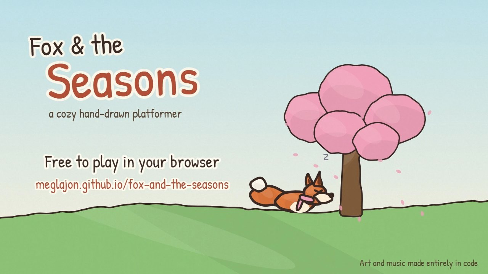

# Fox & the Seasons

A cozy, hand-drawn 2D platformer that runs in your browser. Help Fennel the fox wake up the
seasons of Foxhollows: run, jump, bop grumpy critters, and use the power of **Spring** to sprout
bounce-flowers and climbing vines.

Everything is made in code, with no image or audio files:

- **Art**: wobbly "boiling" ink lines, watercolour fills and paper grain, drawn on a canvas.
- **Music**: an original lo-fi soundtrack composed as note data and played by a small
  synthesizer, with tape wobble, vinyl crackle and layers that react to the season you choose.

## Trailer

[](https://meglajon.github.io/fox-and-the-seasons/media/trailer.mp4)

**[▶ Watch the 20-second trailer](https://meglajon.github.io/fox-and-the-seasons/media/trailer.mp4)**. It's
real gameplay, recorded straight from the game with its own soundtrack. You can also watch it from the
title screen.

To re-record it after changing the game, open `trailer.html` with the local server and press
**Record & download**, then run `python tools/fix_mp4_duration.py` on the file so players show its
full length.

## Play

Open the GitHub Pages link for this repo (see "Publish" below), or run it locally:

```bash
python tools/serve.py 8080
```

Then open <http://localhost:8080>.

## Controls

| Action | Keyboard | Gamepad |
| --- | --- | --- |
| Move | ← → or A D | Stick / D-pad |
| Jump (hold for higher) | Space or Z | A |
| Sprint / carry / throw | Shift or X | X |
| Next / previous season | E / Q | RB / LB |
| Use / talk / climb | ↑ or W | Up / Y |
| Flip furniture | F | Y |
| Pause / settings | Esc | Start |

Every key can be changed in the **settings cabinet** (Controls drawer).

**On phones and tablets** on-screen controls appear automatically: a direction pad on the left, and
**A** (jump), **B** (run / carry), **↑** (use) and **⟳** (season) on the right. Hold the phone upright and
the controls sit below the game; turn it sideways and they move into columns either side of the game.
You can switch them on or off in the settings cabinet (Display drawer → On-screen controls).

## What's in this build

- Title screen with 3 save slots and the trailer
- **Fennel's Den**, with Animal Crossing-style decorating: a grid with two wall heights and three floor
  depths. Pick things up, move them cell by cell, flip them, and change the wallpaper and flooring.
  It also has the wardrobe (fur, scarves, hats, extras, name), the settings cabinet and a storage chest.
- **Catalogue shop**: Cozy, Garden, Harvest and Frost furniture sets, wall decor, rugs, 6 wallpapers,
  6 floors and outfits, all bought with acorns
- Level map of Foxhollows
- **Foxhollows Square**: 2 tutorial levels
- **Bloomwood** (Spring): 4 levels and the *Overgrown Pumpkin*
- **Millpond Reach** (Winter): 4 levels, including *The Thaw*, and *Old Pike*
- **Copperleaf Orchard** (Autumn): 4 levels, including the *Leaf Storm* climb, and *The Prize Scarecrow*
- **Sunglass Greenhouse** (Summer): bake mud solid, melt ice walls, ride heat grates and light up dark
  potting sheds. Cactus hedgehogs, shadow slugs, the *Heatwave* (hide from the sunbeams) and *the Sunlamp Moth*
- **The Almanac Trail**: 20 tricky levels on their own map that need all four seasons, often within
  a few seconds of each other, including dark, auto-scrolling and heatwave stages
- **Secret burrows**: 5 hidden puzzle rooms, each holding a **Starbloom** that makes you invincible
  for 10 seconds back in the level
- 10 lives, extra lives from acorns and berries, checkpoints, golden seeds and unlockables
- 9 original music tracks plus sound effects
- On phones: on-screen controls, with the run button as a tap-on/tap-off toggle

The Hollow Oak finale comes in the next build.

## Publish on GitHub Pages

1. Create a repo on GitHub and push this folder to it.
2. In the repo, go to **Settings → Pages**, set **Source** to *Deploy from a branch*, and pick `main` / `/ (root)`.
3. After a minute your game is live at `https://<your-username>.github.io/<repo-name>/`.

## Project layout

```
index.html          the page that boots the game
src/core/           loop, input, saving
src/art/            hand-drawn art in code (tiles, fox, critters, furniture, backgrounds)
src/audio/          synth instruments, soundtrack and sound effects
src/game/           levels, player physics, critters, rewards
src/scenes/         title, den, map
src/ui/             menus, dialogue, settings cabinet, wardrobe, shop
tools/serve.py      local dev server (no caching)
```
